<div align="center">


# TokenPulse

**Your AI usage, at a glance.**

A desktop tray companion for local AI CLI token usage,<br>
official five-hour and weekly subscription quotas, recent consumption trends,<br>
provider switching, account pools, model speed, sessions, egress, and concurrency.

> TokenPulse is currently a 0.x preview. Features change frequently; stable releases will start at 1.0.

[](https://github.com/JohnMuyuan/TokenPulse/releases/latest)
[](https://github.com/JohnMuyuan/TokenPulse/releases)


[**Download**](https://github.com/JohnMuyuan/TokenPulse/releases/latest) · [Features](#features) · [Screenshots](#screenshots) · [How it works](#how-it-works) · [Privacy](#data-and-privacy) · [Development](#development)

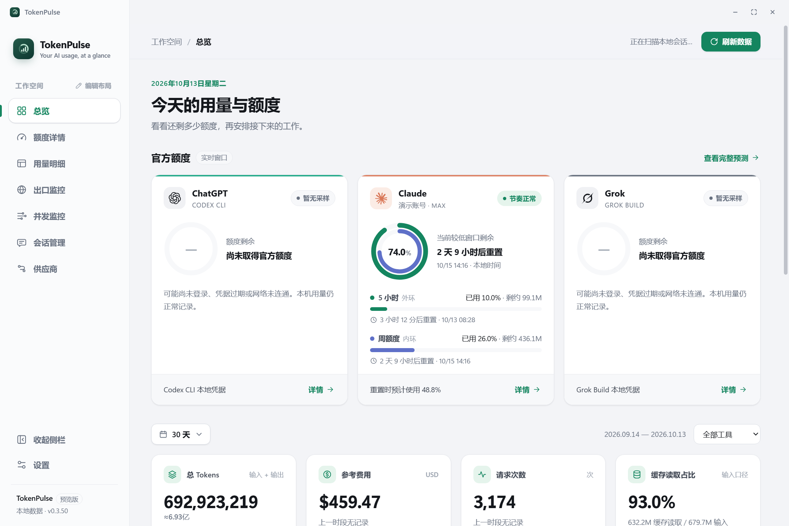

</div>

See [Releases](https://github.com/JohnMuyuan/TokenPulse/releases) for version-by-version changes. The app also shows a one-time introduction after upgrading.

**0.3.59** makes quota-limit warnings less sensitive: a small projected overrun is explained in text; warning colors appear when a longer gap before reset is expected. Configure tolerance for each quota window in Settings → Notifications.

**0.3.58** adds pi sessions, details, full-text search, terminal continuation, and provider switching.

## Share cards and milestones

The top-bar Share card opens monthly reports for any month with usage. Reports include an activity calendar, model rankings, nighttime usage, fastest model, cache savings, and approximate everyday equivalents. Enter monthly subscription costs to compare against estimated API list-price value. A reminder appears on days 1–7 for the previous month. Milestones cover cumulative tokens, daily usage, streaks, reference API value, and request counts; achievements appear in the badge collection. The first opening records existing badges without replaying their notifications.

Cards follow the interface language, with a preview before saving PNG or copying the image. Emails, account names, project paths, and conversation bodies are excluded. Pool/provider names are optional and hidden by default. Images are generated locally and shared by you. API value and cache savings are estimates.

Pool quota pages include survival analysis: remaining weekly quota, member exhaustion and resets, comparisons with previous weeks, and a seven-day simulation based on average usage over the last seven days. Missing or stale samples suppress predictions. Confidence is the proportion of historical daily-usage simulations that lasted. Only official members' weekly quotas are modeled, including web and other-device consumption; API-key members can still forward requests.

Version 0.3.50 expanded the seven-chapter onboarding tour and combined members of each account pool into one model-speed series.

## Provider switching and local routing

The Providers page has sections for Overview, Claude Code, Claude Desktop, Codex, Grok CLI, DeepSeek Harness, Routing service, Forwarding records, Import providers, and Configuration protection. Save multiple providers per tool, click Enable to switch, edit through a step-by-step sidebar, and drag to reorder. Switching changes endpoint, credentials, and model settings while preserving plugins, hooks, MCP, and comments.

When tool and API formats differ, the tool connects to `127.0.0.1`; TokenPulse forwards to the selected provider and translates text and function calls between Anthropic, OpenAI Chat, and OpenAI Responses. Fallback providers can take over after 429 or 5xx responses. Providers can also be switched from the tray. Exiting restores direct configuration; the next launch reconnects routing.

Provider switching preserves the tool's official login. Import existing CC Switch providers. To change the official account used by a CLI, use Settings → Official accounts → Switch to CLI.

**Proxies:** outbound routing, quota checks, egress detection, and updates use environment proxies such as `HTTPS_PROXY`, then the system proxy, then direct access. Local addresses always connect directly. Local routing supports HTTP proxies; SOCKS proxies fall back to direct access. CLIs launched by TokenPulse inherit their normal terminal network environment.

- **Provider icons:** match by name/address, choose from 25 built-in vendor icons sourced from AllAi, or upload an image resized to 128px.
- **Account pools:** Claude Code, Codex, and Grok CLI pools combine registered official accounts and saved API-key providers. DeepSeek Harness pools use API-key providers. Strategies are round-robin, use-until-full, reset-soonest, and most-remaining. Failover handles 401, 402 (including Grok quota exhaustion), 403, 429, 5xx, and connectivity errors; repeatedly failing members pause for 60 seconds. Official accounts below 1% remaining or recently returning 402/429 go last and rejoin automatically after recovery. Reset-soonest prioritizes weekly windows approaching reset with quota remaining. Most-remaining switches only when another member has over five percentage points more. Samples older than 30 minutes are treated as unknown. Each pool has a quota page with totals, usage, allocation, timelines, and requests; tabs can be reordered. Official members change authentication only, preserving CLI request content. Pool credentials are never written to tool configuration, and pools require local routing. Check provider terms when rotating multiple subscriptions.
- **Transparent forwarding:** disabled by default. For official Claude Code, Codex, and Grok logins, it measures time to first token, output tokens per second, usage, and returned model while forwarding headers, credentials, and content unchanged. It listens only on `127.0.0.1` and does not save credentials or message content. Claude uses `ANTHROPIC_BASE_URL`; Codex uses top-level `openai_base_url` while retaining its built-in provider; Grok uses `[endpoints] cli_chat_proxy_base_url` and per-official-model `base_url` entries, preserving custom endpoints. Grok auxiliary calls are forwarded, with only chat and errors recorded. Disabling or exiting removes the added configuration; restarting restores an enabled setting. Switching to a third-party provider or pool disables transparent forwarding. Reopen existing sessions after configuration changes. Claude Code Remote Control is unavailable while its endpoint is redirected; disable forwarding before using it.
- **Model-speed charts:** local routing already measures speed. Usage details show output speed or first-token latency by model, provider, and reasoning level, combining members of the same pool. Choose 24 hours, 7 days, 30 days, or all time; filter by tool and toggle series. Account quota pages show per-model trends, median speed, comparable bars, and separate fast-mode rows. Records are retained indefinitely.
- **Configuration preview:** open a provider's preview step directly from its row or active-provider card. Secrets are masked.
- **Pool attribution:** Claude Code and newer Codex requests are matched to accounts using shared response IDs, never guessed by time alone. Grok logs aggregate whole turns without response IDs, so forwarding records within the turn distribute usage proportionally. Single-member turns receive that account label; mixed turns contribute to hourly account totals without a single request account. Forwarding records and speed charts show actual members.
- **Codex 1M context:** enable `model_context_window = 1000000` and `model_auto_compact_token_limit = 900000`, or enter custom values.

### Configuration protection

- Preview masked line-by-line differences before writing Claude/Codex/Grok configuration. If another process changes the file after confirmation, the write is refused. Formatting, comments, and unrelated settings are preserved.
- Restore any of the last 50 changes in Providers → Configuration protection; restores can also be undone. The original file from before TokenPulse's first change is kept permanently.
- Read-only protection blocks configuration writes, provider switching, and enabling routing. Disabling routing and restoring backups remain available.

### Configuration drift notifications

When another tool changes a previously managed endpoint, or Grok resumes a session with an older model, TokenPulse explains the affected tool, current destination, and likely reason, with a Switch back action using the same diff confirmation. Tray mode uses system notifications. Each change is reported once. Ordinary permission/theme changes and `/model` changes within the same provider are ignored.

Grok may write a default model when resuming or running `/model`; official promotions may also select a new model. TokenPulse treats default-model changes as Grok activity, reconnects your selected provider at startup, and disables model-changing promotions when switching to a third-party provider or pool. Reopen Grok windows to load changes.

Grok's `/model` list identifies routing as `TokenPulse · Provider name`. **For a Grok pool, start a new session or run `/model tokenpulse_route` in the old session**, otherwise resuming may restore the old model.

### Codex configuration validation

Before switching providers or enabling routing, the installed Codex reads the proposed model catalog in an isolated temporary directory, without network access or the real `~/.codex` directory. If a Codex update rejects the format, TokenPulse skips writing that catalog and explains the problem; Codex can still start with its built-in list. Startup can repair invalid catalogs left by older versions, with a backup; read-only protection permits a warning only.

### Retired Prism bridge

The bridge formerly let Codex use full models through your Prism account. After Prism removed 6.1 Sol, 5.6 Sol, and 5.6 Terra in early October 2026, leaving only 6 Luna, the feature was retired and is hidden for users who never installed it.

Existing installations retain a Prism bridge page under local routing with the retirement notice. The service can still start with 6 Luna. The double-confirmed Delete all action stops it and removes its runtime, installation-downloaded Chromium, login data, logs, and Codex provider, switching Codex to official login first if necessary. The page then disappears. Existing system Python and TokenPulse are preserved.

Based on Prism Bridge by [@yyyllllming](https://github.com/yyyllllming), MIT; source and modification notices are in `vendor/prism-bridge/` and its `NOTICE.md`.

## Usage outside this computer

Official quotas cover the whole account, including web, apps, and other computers. TokenPulse compares quota-sampling intervals:

- Quota increases without local Code requests are classified as outside-computer usage, excluded from capacity conversion, and shown on a separate model/reasoning timeline track.
- Increases alongside local Code requests are used for local capacity estimates; simultaneous chat cannot be separated and may make capacity look smaller.
- Split, delete, restore, or annotate outside-computer segments with where, model, and reasoning level; right-drag to select an interval. Annotated periods are excluded from conversion and translated into approximate tokens using that model/level's full-window capacity.

Zoom via right-drag selection, Ctrl+wheel around the pointer, or controls; left-drag to pan when zoomed. The question-mark legend explains tracks and markers. Capacity trends and model comparisons use the same attribution rules.

For accounts used only for Code on this computer, enable Only use Code locally in Settings → Accounts for direct local-usage/used-percentage conversion.

## Models and reasoning levels

- Quota details ranks available model/reasoning combinations for both five-hour and weekly windows: full-window tokens, calls, and remaining capacity. Sort by capacity, requests, frequency, or name and filter by reasoning level.
- The last 30 days of samples estimate an API-equivalent full-window budget, including mixed-model intervals, then convert using reference token prices. Sufficient pure intervals use directly measured values labeled Measured.
- Current and historical model/reasoning timelines show a track per combination with the official used-percentage curve. Filter by a combination and browse prior windows.
- Requests routed to another vendor by tools such as CC Switch are excluded from the original provider's quota. Unknown historical reasoning levels stay unknown; retained logs are backfilled where possible.
- Row details explain both window capacities, input/cache-read/cache-write/output prices and sources, token-mix weighting, reasoning multipliers, call counts, remaining calls, and approximate new content rather than repeatedly cached context.
- Price labels distinguish official discounts, conflicting price tables (using LiteLLM), official increases/decreases with itemized changes, and replacement of family estimates by actual model prices.
- Add unused models for estimates. Sparse reasoning data uses your measurements first, then [Epoch AI](https://epoch.ai/data/ai-benchmarking-dashboard) benchmarks (CC BY 4.0).
- Catalog entries come from local caches, official documentation, and logs; they do not guarantee model entitlement. API-equivalent value is not subscription credit.

## Egress monitoring

Open Egress monitoring, run Check now, enter allowed IPs or add the current IP, save, and enable. Check selected official domains every 5–60 seconds (default 10), with multiple IPv4/IPv6 addresses and optional region allowlists. Two consecutive anomalies notify once per incident. Pause monitoring or review the latest 50 changes.

- Detection uses each domain's trace information, without account tokens or model/quota API calls. It represents that domain through TokenPulse's network configuration, rather than every application's routing.
- ChatGPT, OpenAI API, and Claude have separately verified official region lists, with source and verification date; lists become unverified after 90 days. Grok's complete list is unverified, so use custom regions.
- Unknown regions, detection failures, and subregional restrictions are reported explicitly; detected IP/region does not guarantee account access.
- Cards show flag, IP, city, ASN, network type, and public risk/VPN/proxy/datacenter information from proxycheck.io, ip-api.com, ipinfo.io, and ipapi.is. Lookups occur when the egress IP changes and cache for 12 hours. They disclose that IP to these services and can be disabled at the page top.
- Before quota checks or credential refresh for providers with an IP allowlist, TokenPulse verifies the egress IP. A mismatch or unknown IP pauses these operations and raises an alert, shown on overview and quota pages.
- When monitoring is enabled, CLI launches from TokenPulse—including new chats/projects, terminal continuation, and in-app replies—check the provider allowlist first. An IP list takes precedence; otherwise a region list applies. Failed or indeterminate checks block launch. With neither list, or monitoring disabled, launch proceeds. Terminal checks run in that PowerShell environment and display red/green results there.
- Configuration and recent alerts stay local. Monitoring continues in the tray and stops on exit.

## Concurrency monitoring

Track active AI requests, client connections, and upstream connections, with per-interval peak history and provider/account breakdowns. Set provider limits to notify or reject new requests with 429 for tool retries. History retention is configurable; gaps mean monitoring or the application was inactive. Only local routing, pools, and transparent forwarding are visible; direct tool connections are outside this monitor.

## Desk pet

Off by default; turn it on from the Desk pet page. A small pixel squirrel, hamster, or octopus sits on your desktop and shows the remaining quota of the official account you're using (acorn pile, cheeks, or body color) and whether Claude Code or Codex is running a task on this computer. Click it and a pixel speech bubble shows that account's 5-hour and weekly quota; drag it anywhere, or right-click to see running tasks and more. Task status is inferred read-only from local session files; no tool configuration is changed. You can also import your own pet: a folder with `pet.json` and PNG, GIF, WebP, or JPEG images per state.

## Features

### Local usage

Incrementally read CLI session logs, including terminal, IDE extension, and other frontend activity. Usage scanning itself does not modify Base URLs, install a proxy, or intercept traffic.

### Official quotas and account switching

Reuse CLI credentials for five-hour/weekly quotas, remaining capacity, reset countdowns, recent-trend exhaustion estimates, and projected usage at reset. Add either the CLI's current login (read fresh without saving a copy) or separate TokenPulse logins with stored credentials and automatic renewal. Registered logins can replace Claude Code, Codex, or Grok CLI accounts via Switch to CLI; the previous account remains available in TokenPulse. Multiple accounts have separate quotas; create pools explicitly on the Providers page.

### Usage details and export

Inspect individual requests or daily/tool/model aggregates, including tokens, estimated quota share, origin, and model checks. Date ranges include today, rolling 24 hours, 7/14/30/90 days, all time, or calendar-selected endpoints. Data is retained indefinitely. Numbers show exact units, with an additional compact approximation in Chinese. Searchable exact model multiselect combines with project, account, channel, verification, and keyword filters; filters persist between request and daily views. Sorting, pagination, summary cards, and CSV follow filters; export includes **all** matching records. Failed queries can retry with their filters intact.

Analysis includes yearly daily activity colored by tokens/cost/requests, busiest day, longest streak, clickable days, per-tool trends, complete tool/model rankings, hourly patterns, and weekday-by-hour distributions. Today uses hourly trends. Forwarded requests include first-token latency, total duration, output speed, endpoint, streaming state, and forwarding provider. Non-forwarded records and unmatched Grok turn aggregates show no per-request latency.

Optional tokens.ci upload has a first-run wizard: check Node.js, choose public leaderboard or privacy mode, authorize GitHub in the browser, preview disclosure, and select an interval. TokenPulse schedules every 10 minutes to one day (default hourly), optionally on launch, without system scheduled tasks. It pins a tokens-cli version by default.

### Tray and appearance

Closing the window keeps TokenPulse in the tray. Optional startup login integration, hover quota summary, and a right-click panel show each account's five-hour and weekly progress, reset time, time-elapsed marker, and pressure warning. Scroll with more than three accounts. Switch providers per tool; refresh and exit are at the top right. Light, dark, and system themes are available. Scanning runs in a worker thread.

### Model verification

Request records include time, project, account, requested model, tokens, cost, and response ID. Compare requested and returned models; mismatches and suspicious response formats raise system notifications and an unread sidebar dot cleared on opening details. Grok `-build` billing names are treated as equivalent. Verification reads local data without extra model calls. Ordinary Codex logs lack returned-model names, so only response format can be checked; forwarding captures returned models for the same checks.

### Sessions

Browse Claude Code, Codex CLI, Grok Build, and DeepSeek Harness histories with agent/project/keyword filters, copy project paths, and reply with streaming output. Claude/Codex/Grok support read-only or file-edit permissions and confirmed permanent deletion. DeepSeek sessions support viewing and replies. New chat/project launches the chosen tool in a project terminal. Injected environment/system information and subagent logs are filtered, tools collapse into rows, and titles come from the CLI. Cached indexes open in tens of milliseconds.

### Layout and onboarding

Edit layout exposes drag handles and hide buttons on cards and sidebar pages, with undo, in-place restore placeholders, a per-page layout panel, and reset defaults. Provider quota groups and account tabs can be hidden independently. Preferences stay local.

The seven-chapter first-run tour covers getting started, overview, quotas, usage, providers, sessions/monitoring, and personalization/settings, with direct chapter navigation. Fictional demo accounts are confined to the tour, then real data returns. Reopen it in Settings → About.

### CC Switch history and model knowledge

Read-only import from [CC Switch](https://github.com/farion1231/cc-switch) recovers older cleared CLI sessions and tools not directly scanned, such as OpenCode. Overlapping tool/day data is counted once. Upstream model information from its local proxy can inform verification.

`knowledge/models.json` stores prices, model equivalences, reasoning rules, and consumption factors. Daily GitHub Actions updates use LiteLLM with OpenRouter cross-checks and Epoch AI reasoning data (CC BY 4.0); the app downloads updates daily. Manual overrides live in `knowledge/manual.json`. English and Simplified Chinese apply to the interface, tray, and notifications.

### Supported tools

| CLI or source | Local usage | Official account | Quota information |
| --- | :---: | --- | --- |
| **Claude Code** | ✅ | Claude | Five-hour and weekly percentages/reset times |
| **Codex CLI** | ✅ | ChatGPT | Five-hour and weekly percentages, subscription tier, manual resets |
| **Grok Build** | ✅ | Grok | Weekly percentage, billing cycle, remaining resets |
| **DeepSeek Harness** | ✅ | — | Pay-as-you-go balance with multiple API keys, spending trend, remaining days, timelines, speed, and per-model capacity; provider/pool switching and session viewing/replies |
| **Third-party relay keys** | — | — | sub2api, new-api/one-api balance, key quotas/rate windows, expiry, and daily usage |

> [!NOTE]
> Gemini CLI, Qwen, iFlow, and Copilot currently do not write per-request usage locally. Once available, support can be added in `roots()` and parsers in `src/core/usage-scan.ts`.

## Screenshots

All screenshots use built-in fictional demo data, documentation-only egress addresses, and fictional providers/domains/keys. They contain no real accounts, usage, or egress information.

| Quotas | Capacity |
| --- | --- |
| 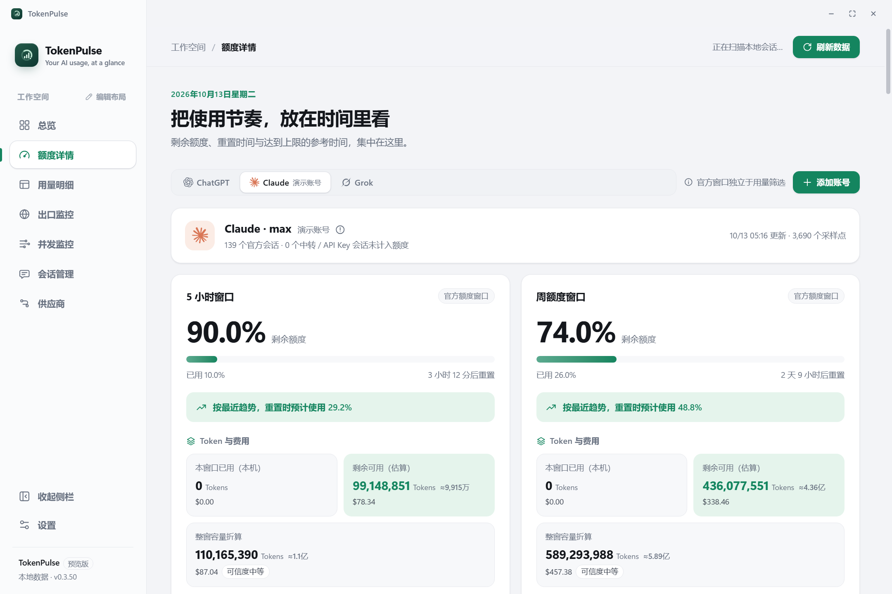 | 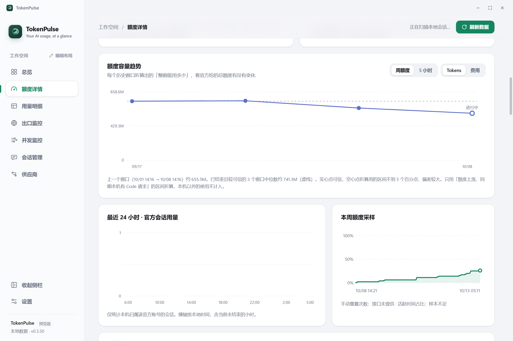 |
| 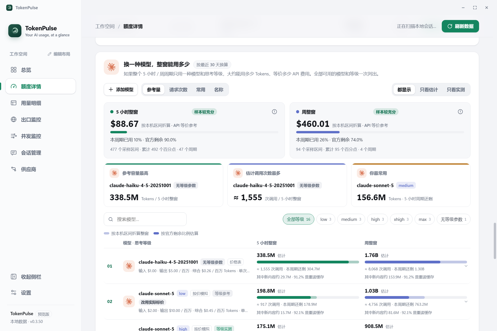 | 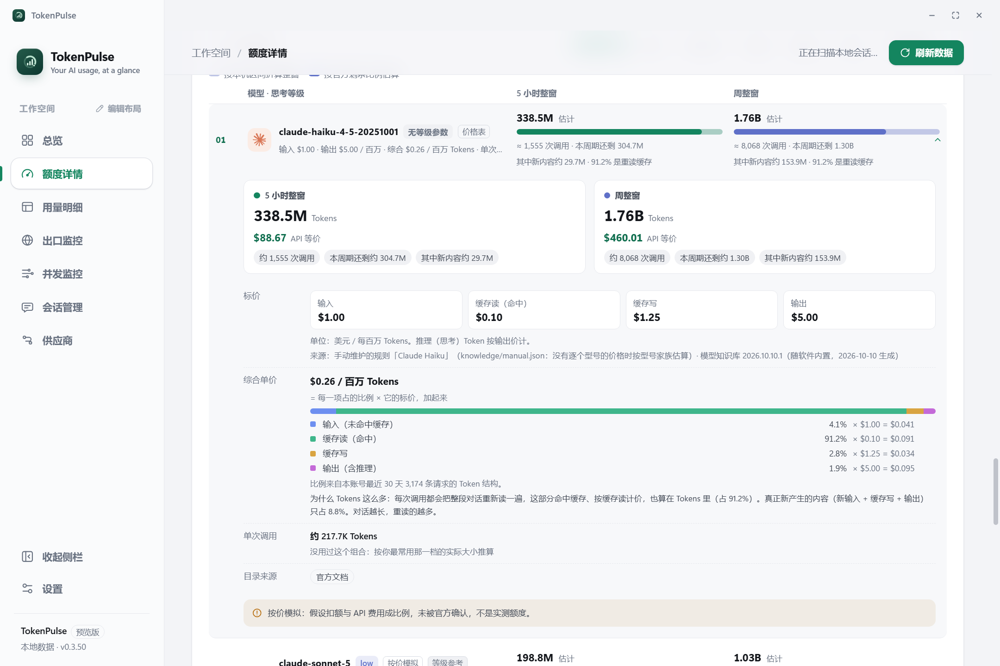 |
| 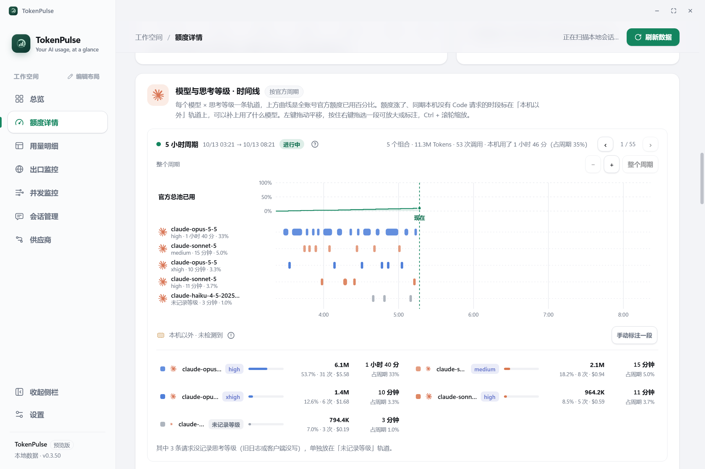 | 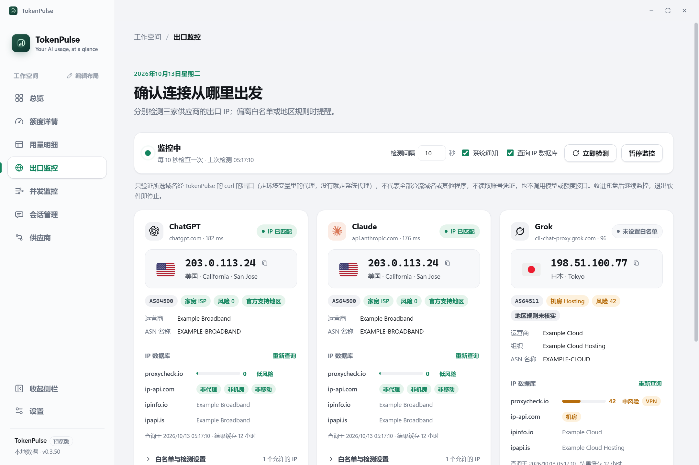 |
| 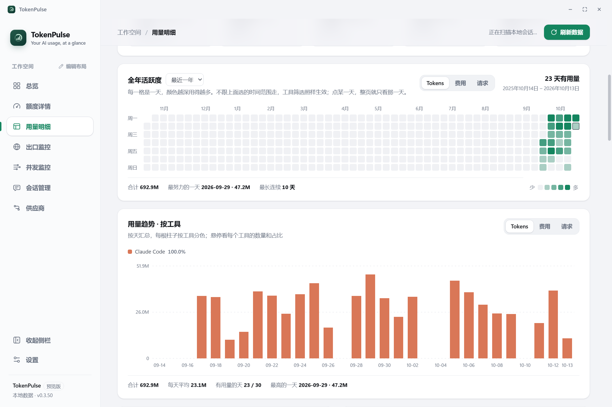 | 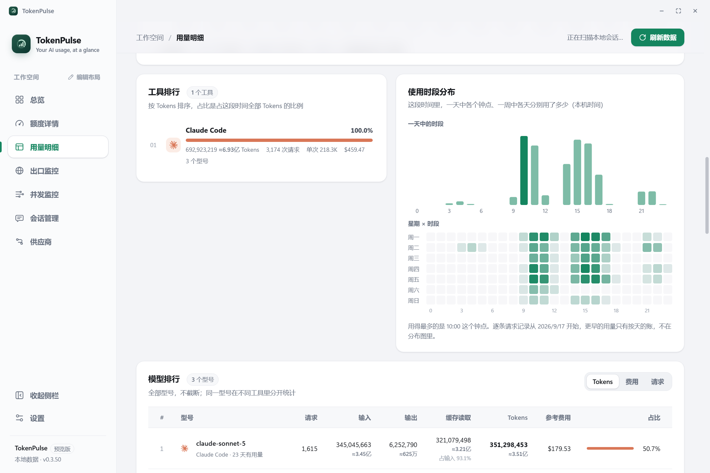 |
| 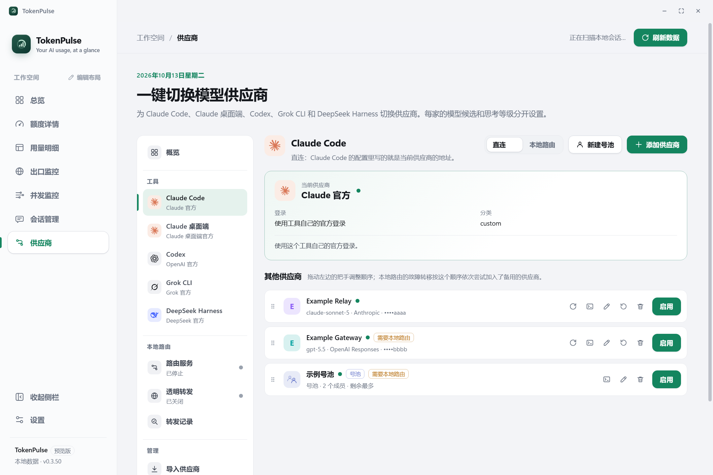 | 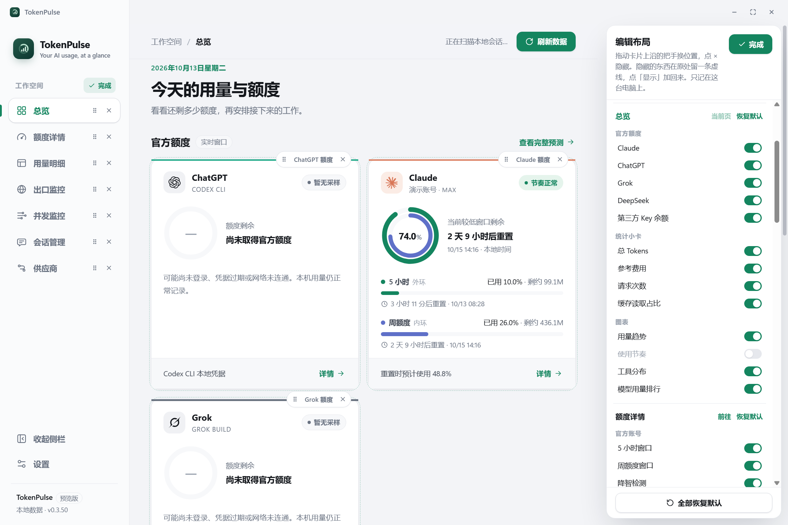 |
| 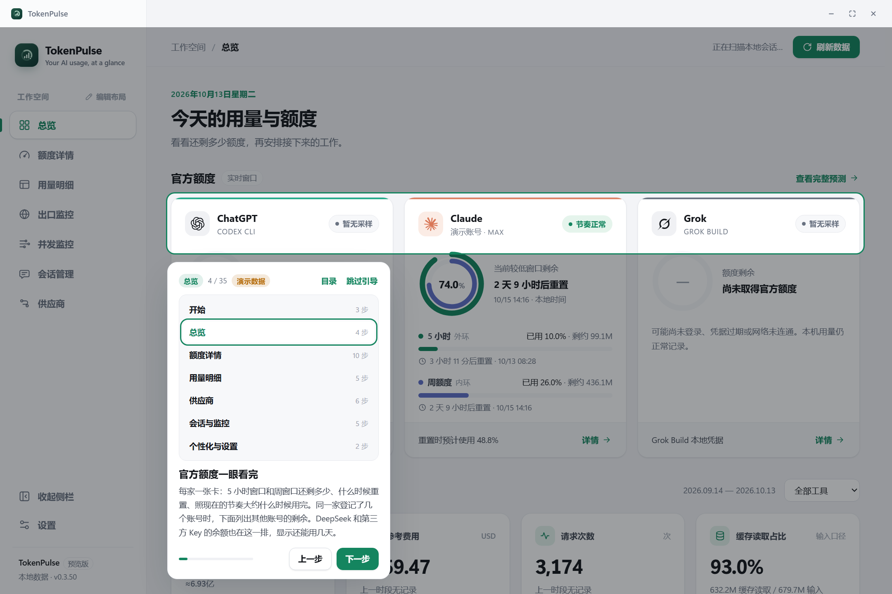 | 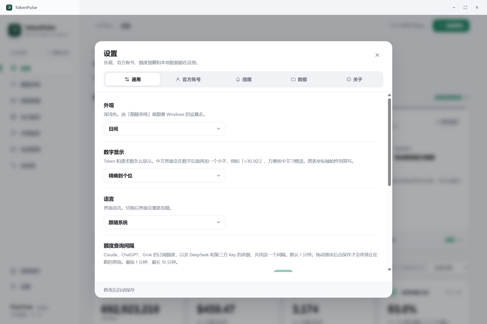 |
| 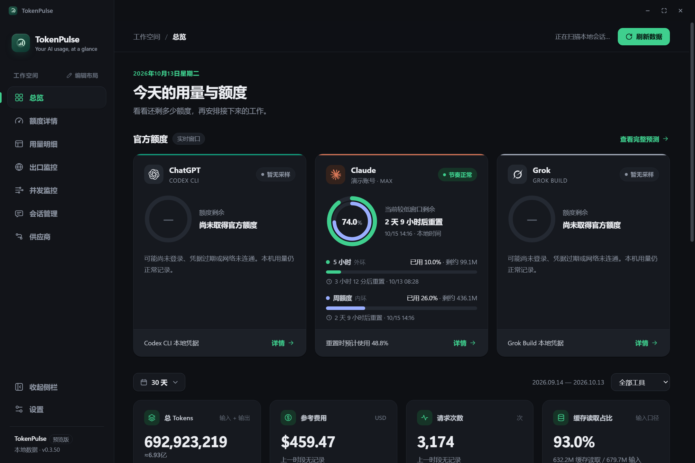 | 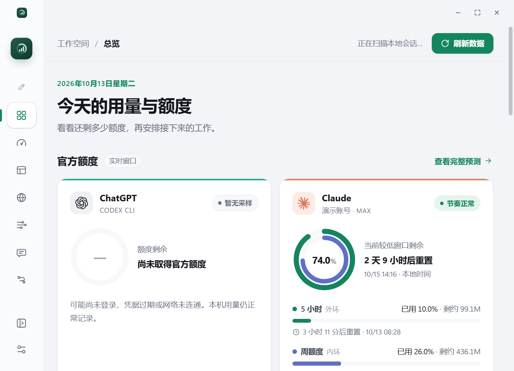 |

## Installation

Download from [Releases](https://github.com/JohnMuyuan/TokenPulse/releases/latest):

| File | Description |
| --- | --- |
| `TokenPulse-x.y.z-Setup.exe` | Recommended installer; selectable directory and Start menu shortcut |
| `TokenPulse-x.y.z-Portable.exe` | Single-file portable edition |

Closing the window returns to the tray. **To exit, right-click the tray icon and click Exit at the top right of the panel.**

The installed edition checks and downloads updates in the background, then silently installs and restarts when the window is minimized or returned to the tray. Settings → About offers notification-only mode and manual checks. Portable users download updates manually.

> [!TIP]
> Installers are unsigned. Windows SmartScreen may require More info → Run anyway on first launch.

Use at least one supported CLI locally first. Official quotas require a corresponding official login; missing/expired credentials affect only that provider.

## How it works

### Usage sources

CLIs record usage after API calls. TokenPulse reads their session files incrementally by byte offset, avoiding repeated full reads of large logs.

| CLI | Session files |
| --- | --- |
| Claude Code | `~/.claude/projects/<project>/<session>.jsonl` |
| Codex CLI | `~/.codex/sessions/<date>/rollout-*.jsonl` |
| Grok Build | `~/.grok/sessions/**/updates.jsonl` |
| DeepSeek Harness | `~/.dsh/sessions/<workdir>/session-<id>/session.v4.jsonl.zstd` |

Deduplication, cache token accounting, and official/relay attribution have dedicated handling; see §4 of [HANDOFF.md](HANDOFF.md).

### Forecasts

Official APIs provide current used percentages rather than historical samples or token capacities. TokenPulse samples every minute by default, configurable from 1–10 minutes.

- Exhaustion estimates use weighted medians across recent sample spans: the last 24 hours for weekly windows and one hour for five-hour windows, falling back to a full-window average when needed. No recent consumption means no invented exhaustion time.
- Recent 24-hour speed provides an earliest-possible estimate rather than a definitive conclusion.
- Full-window capacity divides local tokens by quota used: 98 million tokens at 24% implies roughly 400 million for the week. Estimates are suppressed below 2% and show confidence.
- Capacity converts percentages into remaining tokens/cost and projected usage at reset. Historical capacity charts exclude windows below 2% or without local usage; below 5% is flagged as less reliable.
- Samples before automatic/manual resets are excluded. When a reset has passed without a fresh API query, the new window starts from zero rather than reusing old values.

Overview rings show the window with the least remaining quota, with projected usage at reset or time to exhaustion below.

### Costs

**Costs are estimates, not bills.** Grok-reported session costs are used directly. Claude/Codex tokens use public prices in `src/core/model-pricing.ts`; unknown prices are labeled Unpriced. Subscription accounting excludes API-key and relay sessions, with counts shown.

## Data and privacy

Data is stored locally under `~/.tokenpulse/`. TokenPulse's own network requests query official quotas and renew stored logins; query DeepSeek/configured relay balances; detect egress and optionally consult public IP databases; download model knowledge daily; and check updates. Routing and transparent forwarding send requests that the tools would already make.

Optional **tokens.ci upload**, disabled by default, runs `npx tokens-cli … submit` on your schedule. That tool determines its own scanned token/model/time payload, excluding conversation content; TokenPulse does not pass its ledger or read the tool's login credentials. `tokens-ci.json` stores settings, last run/result, and a short redacted output tail.

| File | Contents | If deleted |
| --- | --- | --- |
| `usage-rollups.json` | Session scan offsets and totals | Rescan existing logs |
| `quota-history.json` | Permanent official quota samples | Forecast history is lost; official APIs cannot restore it |
| `cc-switch.json` | Read-only imported database cache | Reimport on next scan |
| `cli-logins.json` | Account IDs/emails and login dates, without credentials | Future attribution continues; older records use earliest-known account inference |
| `knowledge.json` | Downloaded model knowledge | Fall back to bundled data |
| `requests/<year-month>.jsonl` | Request time, model, tokens, response ID, working directory; no body | Recover records whose CLI sessions still exist |
| `official-accounts.json` | Registered accounts, selection, and separately added login credentials including refresh tokens | Fall back to current CLI accounts; separately added accounts need re-adding |
| `prefs.json` | Startup, tray, and notification preferences | Restore defaults |

Usage analysis/export concerns metadata rather than conversation bodies; session management displays conversations separately. Normal CLI logins are read without copying. Switch to CLI saves the previous login in `official-accounts.json` for renewal, writes the chosen login to CLI credentials, and backs up the old file in `~/.tokenpulse/backups/cli-switch`. Separately added OAuth credentials are stored locally in `official-accounts.json`, used for account features, and renewed before expiry. Protect it like a password file. TokenPulse does not renew the CLI's own unmanaged login, avoiding unexpected logout. Startup integration uses `HKCU\...\Run\com.tokenpulse.app` and can be disabled.

## Development

```bash
npm install
npm run icons         # Generate packaging/icon.png and tray.png
npm run dist:portable # Build portable edition for local testing
npm start             # Compile and launch
npm test              # Backend, scanning, accounts, requests, knowledge, and dictionaries
npm run test:ui       # Electron UI, forecasts, filters, themes, export, layout, recovery
npm run test:update   # Local fake server: check, download, verify, silent-install trigger
npm run dist          # Generate icons and installer/portable packages; does not publish
```

Settings → Official accounts supports multiple accounts. Add account launches the official CLI's authorization page in your default browser with an isolated temporary login directory, preserving the CLI's existing login. All registered accounts are queried and displayed individually. Reorder, rename, remove added accounts, hide/restore current CLI accounts, and switch registered accounts into the CLI.

TypeScript outputs to `build/`; packages go to `dist/`. Development mode does not write startup registration.

### Structure

```text
src/core/            Electron-independent logic
  usage-scan.ts      Incremental daily/hourly session accounting
  quota.ts           Official quota APIs
  quota-history.ts   Quota samples
  quota-monitor.ts   Rate, forecasts, health
  model-pricing.ts   Model prices
  report.ts          UI snapshots
  request-log.ts     Monthly request append/deduplication/query
  request-verify.ts  Model verification rules
  cc-switch.ts       Read-only CC Switch import via node:sqlite
  knowledge.ts       Daily-updated model knowledge
  report-worker.ts   Background scanning and aggregation
src/main/            Electron tray, timers, IPC, notifications
renderer/            Vanilla JavaScript and inline SVG charts
  data.js            Shared date/filter/aggregate/CSV utilities
  brand.js           Official brand SVG paths
scripts/             Tests, screenshots, icon generation
```

`npx electron scripts/capture-ui.cjs` writes README screenshots to `artifacts/ui/`. It isolates the data directory and home directory in temporary locations, uses built-in fictional tour accounts and providers, documentation egress addresses, and no official quota calls. Each capture checks for emails, the local username, and home paths; a match aborts saving.

### winCodeSign packaging issue

On first Windows packaging, winCodeSign extraction may fail with `Cannot create symbolic link: A required privilege is not held by the client`, referring to `...\Cache\winCodeSign\<id>\darwin\10.12\lib\libcrypto.dylib`.

The archive includes macOS symlinks that Windows cannot create without Developer Mode. This unsigned project only needs `rcedit`; extract once while excluding macOS files:

```bash
CACHE="$LOCALAPPDATA/electron-builder/Cache/winCodeSign"
# First run npm run dist to download the .7z; extraction may fail.
SRC=$(ls -S "$CACHE"/*.7z | head -1)
node_modules/7zip-bin/win/x64/7za.exe x -bd "$SRC" -o"$CACHE/winCodeSign-2.6.0" '-x!darwin*'
rm -f "$CACHE"/*.7z
```

Use the exact directory `winCodeSign-2.6.0`. Check the artifact version with:

```bash
node_modules/app-builder-bin/win/x64/app-builder.exe download-artifact --name winCodeSign
```

### pi

- Sessions are read from `~/.pi/agent/sessions`, overridable with `PI_CODING_AGENT_DIR`.
- Providers support direct OpenAI Chat, OpenAI Responses, and Anthropic, or local routing. Diff previews and backups precede changes; `auth.json` and other providers are preserved.
- Switching changes the default provider/model for new sessions. Existing/resumed sessions need `/model`; project `.pi/settings.json` may override global defaults. Restore pi original configuration to recover the previous selection.
- View, search, and resume pi sessions in a terminal. In-app replies/deletion, pi usage scanning, and official quota queries are not included in this release.

<div align="center"><br><sub>Made with ☕ for people who live in the terminal.</sub></div>
